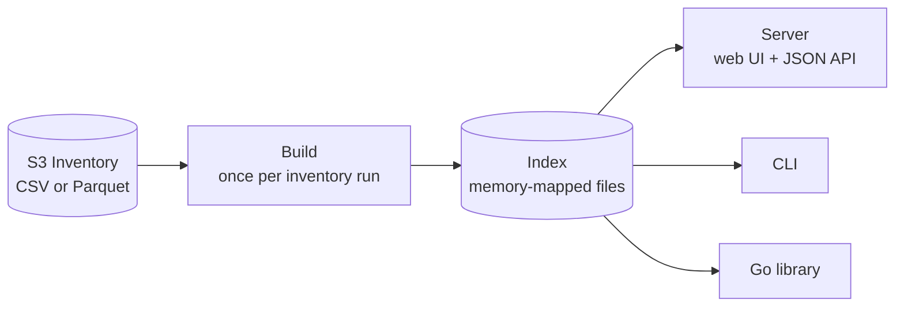

# s3-inv-db

**How much data is under `prefix/`, how many objects, in which storage
classes, and what does it cost?** For a bucket with billions of
objects, S3 has no fast answer: listing is slow and paid, and scanning
an [S3 Inventory](https://docs.aws.amazon.com/AmazonS3/latest/userguide/storage-inventory.html)
report takes minutes to hours per question.

s3-inv-db reads an inventory report once and builds an index of every
prefix in the bucket: its object count, bytes and per-storage-class
totals. After that, any prefix is answered in microseconds, through a
web UI and JSON API, a CLI, or a Go library. It can also rank the
largest prefixes, estimate monthly cost by storage class, and compare
two inventory runs to show what grew, shrank, appeared or disappeared.



For example, on a synthetic 200,000-object inventory (built in under
half a second):

```console
$ s3-inv-db top --index ./my-index --depth 1 --limit 3 --by bytes
Top 3 under "" at depth 1 by bytes:
   1. backups/ — 6171 objects, 2625171166534 bytes
   2. raw/ — 6172 objects, 2567609474695 bytes
   3. processed/ — 6347 objects, 2560367235287 bytes

$ s3-inv-db query --index ./my-index --prefix backups/ --show-tiers --estimate-cost
Prefix: backups/
Objects: 6171
Bytes: 2625171166534

Tier breakdown:
  STANDARD: 1492 objects, 605856109523 bytes
  STANDARD_IA: 953 objects, 410163389930 bytes
  GLACIER_IR: 444 objects, 165850675634 bytes
  …

Estimated monthly cost:
  Total: $31.20/month
  …
```

## What it guarantees

- **Exact answers.** Per-prefix counts, bytes and per-tier totals equal
  a direct scan of the inventory. A build that can't guarantee that
  fails; it never reports success with missing data.
- **Bounded builds.** Building stays within the memory limit
  (`GOMEMLIMIT`) and a documented amount of scratch disk, whatever the
  bucket size.
- **Query cost independent of index size.** Lookups are O(1); listings
  cost the page shown, not the number of children.
- **Never destroys what you had.** A failed build leaves no partial
  index, and the server never removes an index someone is reading.

## Documentation

- [Getting started](docs/getting-started.md): install, build an index, query it, run the server.
- [How it works](docs/how-it-works.md): the build, the queries and the data structures behind them.
- [Operations](docs/operations.md): running the server: disk and memory budgets, monitoring.
- Reference: [configuration](docs/configuration.md), [CLI](docs/cli.md),
  [HTTP API](docs/http-api.md), [Go library](docs/library-api.md),
  [index format](docs/index-format.md).
- Contributing: [development](docs/dev.md), [seeding](docs/seeding.md),
  [releasing](docs/releasing.md), [benchmarks](bench/README.md).

## License

MIT, see [LICENSE](LICENSE).
