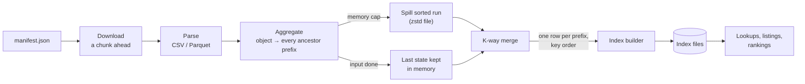

# How it works

How an inventory becomes an index, how the index answers, and which
data structures make that fast. Byte layouts are in
[index format](index-format.md).



## Building

1. **Download and parse.** Parse workers (`min(NumCPU, data files)`,
   at least 2) each have a fetcher downloading their next file while
   they parse the current one. CSV keys, URL-encoded by S3, are
   decoded.
2. **Aggregate.** Each object is added to every ancestor prefix: for
   `data/2024/01/f.csv`, to `""`, `data/`, `data/2024/` and
   `data/2024/01/`. `--max-depth` limits how deep this goes.
3. **Spill.** An aggregator sorts its rows and writes them to a
   zstd-compressed run file when any of these holds: the aggregators
   together exceed `0.15 × GOMEMLIMIT` (512 MiB with no limit); the
   live heap reaches 70% of the limit, or the in-use heap 95%; or a
   50K-row check finds the cap reached mid-file. A worker's last state
   stays in memory unless the heap is under pressure.
4. **Merge.** A K-way merge adds up rows for the same prefix across all
   runs. It reads up to 64 run files at once (about 2.5 MB of heap
   each, within `0.25 × GOMEMLIMIT`); past that, it first merges the
   smallest files in rounds.
5. **Build the index.** The builder checks the stream is complete and
   ordered (every prefix after its parent), hashes each prefix and
   spools it by depth. At the end it writes every file in
   [level order](#level-order-rows) and builds the minimal perfect
   hash.

Scratch lives in a hidden `.<out>.scratch-*` directory beside the
output, never in `/tmp` (which may be RAM). It holds at most two
downloaded files per worker, the run files (deleted as merged), the
level spool (~40 B per prefix) and the hash builder's arrays (~20 B per
prefix). A build that can't produce exact totals fails and removes
what it created; a previous index is left untouched.

## Querying

**Lookup.** Hash the prefix, map it to a slot with the minimal perfect
hash, check the slot's fingerprint (so an unknown prefix is a miss, not
someone else's row), then read the core row at the slot's position.

| Operation | Cost | Warm latency (1M-object fixture, 2.37M prefixes) |
|---|---|---|
| Stats for a prefix | O(1) | ~110 ns |
| Tier breakdown | O(tiers) | ~70 ns |
| Children, a page by name | O(1 + page) | tens of µs at any width |
| Top k by size or count | ~k blocks of 64 rows + one bound per block | ~100 µs over 368k descendants |
| First pages sorted by size or count | same as top k | ~180 µs at 200k children |
| Filter by minimum count or size | blocks skipped or counted unread; O(n) at worst | 0.1–1.6 ms over 368k |
| Sorted by cost, or later pages | O(n log n) once, then O(1 + page) from the level cache | ms at 200k children |

Numbers are from the query gate benchmarks (`bench/suite/query.txt`),
lookups in random order. Cold, add roughly one page fault per file
touched. Query memory is the OS page cache; a warm process looking
large is expected.

## Data structures

### Level-order rows

Every per-prefix file has one row per prefix, at the same position.
Positions run level by level, each level in key order, so a prefix's
children are a contiguous range its row points to:

```
key order          position  child_start   children
""                 0         1             [1, 3): data/, logs/
data/              1         3             [3, 4): data/2024/
logs/              2         4             [4, 5): logs/app/
data/2024/         3         5             [5, 7): 01/, 02/
logs/app/          4         7             none
data/2024/01/      5         7             none
data/2024/02/      6         7             none
```

Listing is two reads; a scan of one level reads consecutive rows. The
cost is that rebuilding a full prefix string walks parents a level
apart (~120 ns). Level order is the "level-order unary degree sequence"
idea ([Jacobson 1989](https://doi.org/10.1109/SFCS.1989.63533)) with
explicit child offsets instead of unary codes.

### Minimal perfect hash (BBHash)

Maps each of the n prefixes to a distinct slot in 0…n−1 using about
3.3 bits per prefix, with a fallback table for the few keys whose
64-bit hashes collide. Each slot stores an 8-byte fingerprint (a second
hash) and the position, so lookups of absent prefixes are rejected.
[Limasset et al. 2017](https://doi.org/10.4230/LIPIcs.SEA.2017.25).

### External merge sort

Aggregation spills sorted runs and a heap-based K-way merge combines
them, which keeps memory bounded for any bucket size
([Knuth, TAOCP Vol. 3 §5.4](https://www-cs-faculty.stanford.edu/~knuth/taocp.html)).
Run files store prefixes front-coded (each sharing the previous
prefix's start) with varint fields, compressed with
[zstd](https://www.rfc-editor.org/rfc/rfc8878).

### Depth-block bounds

For every 64 rows of a level, the minimum and maximum object count
and bytes, as 16-bit codes rounded outward (0.125 B per prefix). Top-k
and sorted pages first find a value k blocks are sure to reach, then
read only blocks whose maximum can beat it; filters skip or count whole
blocks. The idea is block-max indexing from search engines
([Ding & Suel 2011](https://doi.org/10.1145/2009916.2010048)).

### Narrow columns with patches

Counts, byte totals and child offsets take the byte width that makes
the file smallest; the few values that don't fit (the root and top
levels) store a sentinel and their exact value in a patch file, found
by rank over a bit vector. The core row is 10 bytes on the fixture
instead of 14. This is patched frame-of-reference coding
([Zukowski et al. 2006](https://doi.org/10.1109/ICDE.2006.150)); rank
uses a small directory per 512 bits
([Vigna 2008](https://doi.org/10.1007/978-3-540-68552-4_12)).

### Prefix strings

Each row stores its last segment's ID in a dictionary of distinct
segments and the distance back to its parent; a prefix is rebuilt by
walking parents. Each distinct segment is stored once.

### Memory-mapped files

Indexes are read through [mmap](https://man7.org/linux/man-pages/man2/mmap.2.html):
nothing is loaded up front, the kernel caches what queries touch, and
many processes share it. The server prefaults new indexes
(`MADV_POPULATE_READ`) within 1/8 of its memory.
