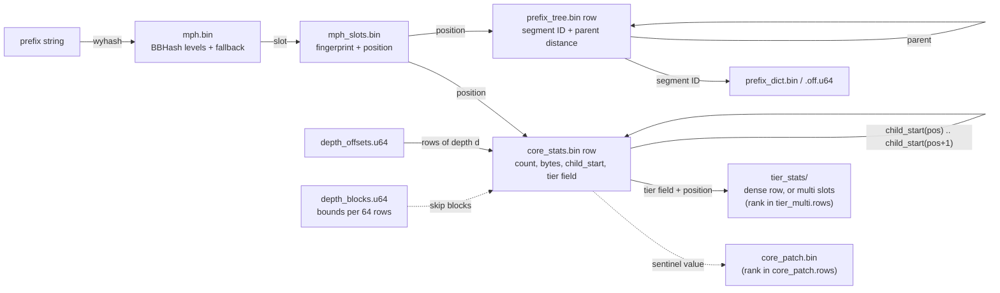

# Index Format

The index uses a row-major file format optimized for memory-mapped access. Each prefix has the same row index (its position, in [level order](#level-order-positions)) in every per-prefix file, so `pos → all stats` is one row read in one mmap.

## What's in the index — and what isn't

The index is **prefix-aggregated only**. The smallest unit stored
anywhere is a prefix; there is no per-object record. Each row in
`core_stats.bin` carries the *sum* of `object_count` and `total_bytes`
over every S3 object whose key sits under that prefix, and the
per-tier file does the same per storage class.

What this **rules out** without re-reading the source inventory:

- The size or storage class of a specific object key.
- "Largest 100 objects under this prefix" / per-object distributions.
- Distinguishing a leaf-object key from a deeper prefix in the tree.

This is a deliberate trade — keeping per-object rows would multiply
on-disk size by orders of magnitude. UI and CLI surfaces should
reinforce the prefix-tree mental model (text labels like "child
prefix", "Browse", "Compare") and **avoid file-system or document
metaphors** (folder/file/paper icons, the word "sub-folder") that
imply per-object operations are possible.

## Directory Structure

```
index/
├── manifest.json
├── tiers.json
├── core_stats.bin
├── core_patch.bin                 (only when patching pays)
├── core_patch.rows
├── depth_offsets.u64
├── depth_blocks.u64
├── mph.bin
├── mph_slots.bin
├── prefix_dict.bin
├── prefix_dict.off.u64
├── prefix_tree.bin
├── build.json                     (CLI builds only; not in the manifest)
└── tier_stats/                    (absent with one present tier)
    ├── tier_dense.bin             (dense layout), or
    ├── tier_multi.bin             (multi layout)
    ├── tier_multi.rows
    ├── tier_multi.off.u64
    └── tier_multi.mask            (multi layout, past 8 tiers)
```

`tiers.json` and the `tier_stats/` files are absent from an index with
no prefixes.

Each prefix is stored in `prefix_tree.bin` as its parent plus one
dictionary segment, described under [Prefix Strings](#prefix-strings)
below.

### How a position ties the files together

A prefix's position is its row in every per-prefix file. The MPHF maps
a prefix string to it; the depth index maps a depth to its rows; each
core row points at its children's rows.



Why each structure was chosen: [how it works](how-it-works.md#data-structures).

## File Header

Every binary file except `mph.bin` and `prefix_dict.bin` starts with
the same 20-byte header (the `Header` struct in `pkg/format`), all
fields little-endian:

| Offset | Size | Field | Description |
|--------|------|-------|-------------|
| 0 | 4 | Magic | `0x53334944` ("S3ID" in ASCII) |
| 4 | 4 | Version | Format version (currently `13`) |
| 8 | 8 | Count | Number of rows |
| 16 | 4 | Width | Row stride in bytes |

Data follows as a packed array of fixed-stride rows (`core_stats.bin`,
`tier_dense.bin` and `tier_multi.bin` put a field-width descriptor
first; see below).

### Variable-width arrays

The `.u64` and `.u32` suffixes name the type a reader decodes to, not
the stored width. At finalize the builder rewrites each of these
arrays at the smallest width in bytes that holds its largest value,
and records it in `Width`:

| File | Width |
|------|-------|
| `depth_offsets.u64` | bytes for the number of rows (1–8) |
| `tier_stats/tier_multi.off.u64` | bytes for the number of stored tier slots (1–8) |
| `prefix_dict.off.u64` | bytes for the segment blob's size (1–8) |

A reader loads 8 bytes at `index × Width` and masks off the bytes
above `Width`. So that this load stays inside the mmap at the last
element, each repacked file ends with an 8-byte zero tail pad.

## Core Stats (`core_stats.bin`)

A single row-major file with one row per prefix at its position, plus, when it pays, two patch files for the few values that
don't fit their field (`pkg/format/core_stats.go`, `core_patch.go`).

Layout:

| Offset | Size | Content |
|--------|------|---------|
| 0 | 20 | Header (`Width` = row width in bytes) |
| 20 | 4 | Stride descriptor: one byte per field, its width in bytes |
| 24 | `Count × Width` | Rows |
| end | 8 | Zero tail pad |

Fields, in row order:

| Field | Width (bytes) |
|-------|---------------|
| object_count | 1–8, patched |
| total_bytes | 1–8, patched |
| child_start | 1–8, patched: the position of the prefix's first child |
| tier_mask | 0–2 |

A field's offset in the row is the sum of the widths before it. On
open the reader checks that the descriptor's widths sum to the
header's `Width`. Rows are packed with no padding: aligning them to
cache lines measured no faster. `tier_mask` holds the prefix's tier
mask, in which bit *i* is set when tier slot *i* (the *i*-th tier in
`tiers.json`) holds data in this prefix, encoded by the tier layout
(see [Tier Statistics](#tier-statistics)): the mask itself, nothing
for the dense layout, or past 8 tiers in the multi layout a 1-byte
code. Its width is 0 when no prefix has data outside slot 0; the mask
is then slot 0 for a prefix with data. A prefix's children are the
positions `[child_start(pos), child_start(pos + 1))`, with
`child_start(Count) = Count`; it has children exactly when that range
is not empty.

A field read is one 8-byte little-endian load masked to the field's
width; the tail pad keeps that load inside the mmap on the last row.

### Patched fields

The root and the top levels carry bucket-wide totals, so
a field sized for its largest value would make every row pay for a
handful. Instead the builder picks each patched field's width from the
data:

- At finalize it reads every row once and counts rows by the widths
  their three patched values need, then sizes every width combination
  exactly (rows × widths, plus the patch files for the rows that don't
  fit) and keeps the smallest whose exceptions are at most 0.5% of
  rows. Exceptions cost a rank and a table read and sit on the upper
  levels that listings read most, so the cap keeps reads fast (#54).
  When no narrower width pays for its exceptions it uses plain widths
  and writes no patch files.
- A value that doesn't fit stores the field's all-ones sentinel (a
  value equal to it needs the next width). Its row's bit is set in
  `core_patch.rows`, a ranked bit vector (layout as in
  `tier_multi.rows`), and the row's exact `object_count`,
  `total_bytes` and `child_start` go to `core_patch.bin` (Header,
  `Width` = 24, then three `uint64`s per exception in row order).
- A reader that loads a sentinel from a patched field (one under 8
  bytes in an index with patch files) reads the exact value at
  `rank(pos)` in `core_patch.bin`; every other read is the plain load.

On the 1M-object benchmark fixture the stride is 1 + 5 + 3 + 1 = 10
bytes with 0.02% of rows patched, against 3 + 7 + 3 + 1 = 14 bytes
unpatched.

During the build the rows are written at a fixed 26-byte stride
(8 + 8 + 8 + 2) into an mmap'd file, in position order (see below). At
finalize the builder streams the rows into `core_stats.bin.tmp` at the
chosen stride and renames it over the build file.

### Level-order positions

Positions number the prefixes level by level: the root `""` is 0, then
every depth-1 prefix in key order, then every depth-2 prefix in key
order, and so on. Each depth's prefixes are one contiguous range of
positions, and within it siblings are adjacent and in S3 key order, so
every prefix's children are one contiguous range too:
`[child_start(pos), child_start(pos + 1))`.

```
Key order          Position  child_start
""                 0         1
data/              1         3
data/2024/         3         5
data/2024/01/      5         7
data/2024/02/      6         7
logs/              2         4
logs/app/          4         7
```

The children of `data/` (position 1) are positions `[child_start(1),
child_start(2)) = [3, 4)`: `data/2024/`. Descendants k levels down are
the children of the children's range, k steps of two reads: the
children of positions `[lo, hi)` are `[child_start(lo),
child_start(hi))`. A listing, a filter or a ranking over one level
reads its rows in sequence.

Rows arrive in key order, which is not position order, so the builder
spools each prefix by depth (one file per depth in its temp directory,
about 40 B per prefix) and writes every per-row file at finalize,
depth by depth: a prefix's first child is the number of rows already
seen at the next depth when it arrives, and its parent is the last row
seen at the depth above.

## Depth Index

Rows are grouped by depth, so the depth index is where each depth
starts, plus stats bounds per block of rows:

| File | Description |
|------|-------------|
| `depth_offsets.u64` | `depth_offsets[d]` = the first position at depth `d`; a trailing sentinel holds the total |
| `depth_blocks.u64` | Per block of 64 consecutive positions of one depth, bounds on their object counts and bytes |

The prefixes at depth 2 are positions `[depth_offsets[2],
depth_offsets[3])`. A reader keeps the offsets in memory (one per
depth) and finds a position's depth with a binary search over them.

### Block bounds (`depth_blocks.u64`)

Each depth's rows are cut into blocks of 64 from its first row, the
last block possibly shorter; blocks never span two depths. Depth `d`
has `ceil((depth_offsets[d+1] − depth_offsets[d]) / 64)` blocks, stored
depth after depth, so a reader finds depth `d`'s first block from the
offsets alone and checks the file holds exactly the total on open.
Each block is one 8-byte word of four 16-bit codes,
from the low end: minimum count, maximum count, minimum bytes, maximum
bytes.

A code is a small float: below 1024 it is the value itself; above, its
top 6 bits are an exponent `e ≥ 1` and the value is
`(1024 | low 10 bits) << (e − 1)`, saturating at `2^64 − 1`. Minimums
round down and maximums up, so a block's bounds hold every entry, at
most 0.1% wider than its true extremes. 0.125 B per prefix.

Ranked queries (top-N, early size and objects pages) and filtered
descendant pages read the bounds first and skip blocks that can't
contribute. A ranking first finds a value k whole blocks are sure to
reach (the k-th largest of each block's guaranteed best), then scans
blocks in position order, skipping any block whose bound falls below
that value or, with k results held, at or below the k-th (a later
position loses the tie). That reads about k blocks of stats, plus one
bound per block of the span, unless many blocks' maximums lie within
the bounds' rounding (none below 2048, else up to 0.1%) of the k-th
result: the bounds can't rule those out, so they are scanned too, up to
the whole span (O(d)). A filtered page skips
blocks whose maximums fail the filter and counts blocks whose minimums
pass it without reading them. See [`pkg/format/depthblocks.go`](../pkg/format/depthblocks.go)
and [`pkg/indexread/top.go`](../pkg/indexread/top.go).

## MPHF (Minimal Perfect Hash Function)

The MPHF provides O(1) prefix-to-position lookups with BBHash (Limasset et al., 2017), implemented in `pkg/format/bbhash.go`.

| File | Description |
|------|-------------|
| `mph.bin` | BBHash levels and the fallback table (layout below) |
| `mph_slots.bin` | Per BBHash slot, the prefix's fingerprint and its position |

`mph.bin` layout, all little-endian `uint64`, with no file header:

| Words | Content |
|-------|---------|
| 1 | Level count `L` (0 when every key is in the fallback table) |
| `L` | Each level's length in 64-bit words |
| sum of the lengths | Every level's bit vector, back to back |
| 1 | Fallback entry count `F` |
| `2F` | Each fallback entry's key hash, then its fingerprint, sorted by (hash, fingerprint) |

The file is exactly that long; a reader rejects any other size, a level
or fallback count the file cannot hold, and fallback entries out of
order. `mph.bin` and `mph_slots.bin` must agree on the key count: the
bits set across the levels plus `F`.

`mph_slots.bin` layout:

| Offset | Size | Content |
|--------|------|---------|
| 0 | 20 | Header (`Count` = slots, `Width` = 8 + position width) |
| 20 | 1 | Position width in bytes (the bytes the largest position needs) |
| 21 | `Count × Width` | Slots: 8-byte fingerprint, then the position |
| end − 8 | 8 | Zero tail pad |

The fingerprint and the position share a slot, so a lookup reads one
place: 11 bytes per slot on the 2.4M-prefix benchmark fixture.

### BBHash

Level 0 is a bit vector of about 2 bits per prefix (gamma 2). Each key hash sets the bit chosen by a splitmix64 mix of the hash and the level number. Bits that two keys share are cleared, and those keys move on to the next level, which is sized for them alone. A key's slot is the number of set bits before its own, across all levels. On load the reader builds a rank directory with one count per 512 bits, so that count takes at most eight popcounts. A lookup therefore costs O(levels) however many prefixes the index holds. `mph.bin` holds about 3.3 bits per prefix; with the in-memory rank directory the table is about 3.7 bits per prefix.

### Lookup Algorithm

1. Hash the prefix with wyhash (final v4.3, `pkg/format/wyhash.go`) and seed 0
2. Find the key hash's BBHash slot. A hash that sets no bit on any level is looked up in the fallback table by (key hash, fingerprint) when the table is non-empty; a miss there means the prefix is not in the index
3. Read that slot from `mph_slots.bin`
4. Hash the prefix again with the fixed fingerprint seed (computed once, reused from step 2 on the fallback path); if it matches the slot's fingerprint, return the slot's position, otherwise the prefix doesn't exist

wyhash reads 8 bytes at a time; the byte-at-a-time FNV it replaced was
about 30% of a warm lookup. A non-member query is misreported only if
it lands on an occupied slot and its 64-bit fingerprint also matches
(~2⁻⁶⁴ per lookup). Checking the stored prefix as well would make hits
exact, but walking the prefix tree adds 51–90% LLC misses per lookup
(measured, #53), so lookups stay fingerprint-only.

### Fallback Table

BBHash cannot place two keys with equal 64-bit hashes: they take the same bit on every level. The chance that some two of n prefixes share a hash is 1 − e^(−n²/2⁶⁵), 39% at 4.3 billion prefixes and 93% at 10 billion, so the build expects it. It stops adding levels at the first level that places no key, and the keys still unplaced go to the fallback table, keyed by (key hash, fingerprint). The levels own the first slots, and fallback entry j owns the j-th slot after them. The fingerprint uses its own fixed seed, so prefixes that share a key hash still differ in it. Two prefixes equal in both 64-bit hashes cannot be told apart by a lookup, so the build fails with `ErrMPHFKeyCollision`.

Finding the entries costs one parallel pass over the build's key-hash and fingerprint arrays, checking each hash against the sorted leftover hashes. It runs only when some key is left over. The table is almost always empty or a handful of entries, and a lookup that hits a level never reads it.

## Prefix Strings

Every non-root prefix is its parent prefix, one segment, then a slash:
`data/2024/` is `data/` + `2024` + `/`. The prefix tree stores exactly
that, so naming a child is one row read and rebuilding a prefix is one
row read per level.

| File | Description |
|------|-------------|
| `prefix_dict.bin` | Every distinct segment once, concatenated (no separators) |
| `prefix_dict.off.u64` | Byte offset for each segment in `prefix_dict.bin`; trailing sentinel marks the end |
| `prefix_tree.bin` | Per prefix in position order: its last segment's ID and the distance back to its parent's position (a row of the level above) |

`prefix_tree.bin` layout:

| Offset | Size | Content |
|--------|------|---------|
| 0 | 20 | Header (`Count` = prefixes, `Width` = row bytes) |
| 20 | 2 | Descriptor: segment ID width (1–4), parent distance width (1–8) |
| 22 | `Count × Width` | Rows: segment ID, then parent distance |
| end | 8 | Zero tail pad |

Both widths come from the largest value in this index. The root `""`
is position 0 and its row is zero; every other row has a distance of at
least 1.

To read the prefix at position `p`, walk to the root collecting segment
IDs (`p -= distance` until `p == 0`), then join their segments in
reverse, each followed by `/`. The listing name of `p` (its last
segment) is the segment of its own row.

Because the builder writes each prefix as its parent plus one segment,
it requires the root first and every prefix after its parent;
`IndexBuilder.Add` rejects a prefix that arrives without its parent
with `ErrMissingParent`. Prefixes must also arrive in strictly
increasing byte order, since readers rely on siblings sitting in byte
order of their full prefixes (compare merges two indexes' children by
it); `Add` rejects a duplicate or out-of-order prefix with
`ErrUnsortedInput`. The aggregator always emits every ancestor, in
sorted order.

On Open, all segments are preloaded into an in-memory cache (unique
segments are few next to prefixes: 9,262 segments for 2.37M prefixes
on the 1M-object benchmark fixture), so the warm-path cost is one
cache lookup per segment rather than a blob read.

## Tier Statistics

Tier stats give each prefix's `(count, bytes)` per tier listed in
`tiers.json`; tier slot *i* is the *i*-th tier there (ascending tier
ID). The pipeline declares the present tiers (those with data anywhere
in the inventory) before the first row, so tiers with no data get no
slot. A builder that declares none records all 13 tiers.

Every prefix's per-tier counts and bytes sum exactly to its
`object_count` and `total_bytes`; the builder checks this for every row
and fails the build otherwise. So the files store only what the core
row doesn't already give:

- a prefix whose tier mask has one bit holds all its objects in that
  tier: its totals are the tier's stats;
- in a prefix with several, the highest tier in the mask is the totals
  minus the other tiers.

An index with one present tier writes no tier files at all. Otherwise
the builder computes the exact size of both layouts below at finalize,
each with the core `tier_mask` bytes it needs, and writes the smaller
(dense on a tie). Each stored slot is a count
then bytes, little-endian, at the widths the layout's largest stored
values need (1–8 bytes each), recorded in a 2-byte descriptor (count
width, bytes width) after the header of `tier_dense.bin` and
`tier_multi.bin`. Both files end with an 8-byte zero tail pad.

Tier IDs (0–12) map to S3 storage classes:

| ID | S3 name | Notes |
|----|---|---|
| 0 | `STANDARD` |  |
| 1 | `STANDARD_IA` | 128 KiB minimum billable size |
| 2 | `ONEZONE_IA` | 128 KiB minimum billable size |
| 3 | `GLACIER_IR` | 128 KiB minimum billable size |
| 4 | `GLACIER` | Per-object metadata overhead |
| 5 | `DEEP_ARCHIVE` | Per-object metadata overhead |
| 6 | `REDUCED_REDUNDANCY` | Deprecated by AWS |
| 7 | `INTELLIGENT_TIERING_FREQUENT` | Monitored |
| 8 | `INTELLIGENT_TIERING_INFREQUENT` | Monitored |
| 9 | `INTELLIGENT_TIERING_ARCHIVE_INSTANT` | Monitored |
| 10 | `INTELLIGENT_TIERING_ARCHIVE` | Monitored + Glacier overhead |
| 11 | `INTELLIGENT_TIERING_DEEP_ARCHIVE` | Monitored + Glacier overhead |
| 12 | `INTELLIGENT_TIERING_FREQUENT_SMALL` | Synthetic bucket for IT-Frequent objects < 128 KiB; billed at Frequent rate, excluded from the monitoring fee |

`pkg/tiers.Resolve(id, size)` re-routes IT-Frequent objects below
128 KiB into the synthetic `ITFrequentSmall` bucket at ingest time so
cost estimates honour the AWS minimum-monitored-size rule exactly.

### Dense (`tier_dense.bin`)

Header (`Count` = prefixes, `Width` = (T − 1) × slot width for T
present tiers), the slot-width descriptor, then one row per prefix at
its position holding slots 0 … T − 2, zeros included. Slot
T − 1 is derived. Readers check the row count and width against the
core stats and `tiers.json`. The slots give the mask (a slot holds data
when its count or bytes is nonzero), so the core rows' `tier_mask` has
width 0 and reads 1 for a prefix with data.

### Multi (`tier_multi.bin`, `tier_multi.rows`, `tier_multi.off.u64`, `tier_multi.mask`)

Only prefixes with two or more tiers store anything. With up to 8
tiers the core `tier_mask` is the mask (1 byte). Past 8 the mask would
take 2 bytes in every row, so `tier_mask` is a 1-byte code instead: 0
for no data, *slot* + 1 for a prefix with one tier, `0xFF` for two or
more, whose mask is in `tier_multi.mask`:

| File | Content |
|------|---------|
| `tier_multi.bin` | Header (`Count` = stored slots, `Width` = slot width), slot-width descriptor, then for each such prefix in position order the slots of every tier in its mask except the highest, in slot order |
| `tier_multi.rows` | Header (`Count` = prefixes), a bit vector with bit *pos* set for each such prefix (little-endian `uint64` words), then a rank directory: for every 8 words, the set bits before them |
| `tier_multi.off.u64` | A variable-width array (see above): for the *k*-th such prefix, the index of its first slot in `tier_multi.bin`, plus a trailing sentinel |
| `tier_multi.mask` | Past 8 tiers only: a 2-byte array of the *k*-th such prefix's mask |

To read prefix *pos*: `rank(pos)` (a directory entry plus at most eight
popcounts) gives *k*; its slots start at `off[k]`, and past 8 tiers its
mask is `mask[k]`.

## Manifest

`manifest.json` lists every index file with its size and checksum,
plus the prefix count and maximum depth. `verify` and
`format.VerifyManifest` check each file's size and checksum against it.

A file's checksum is the CRC-32C of the CRC-32Cs of its 64 MiB pieces,
each 4 bytes big-endian, concatenated in order (one empty piece for an
empty file), as 8 hex digits. It guards against accidental damage
only: the manifest travels with the files, so a cryptographic hash
would authenticate nothing, and CRC-32C runs on the CPU's CRC
instructions. The pieces of every file are hashed in parallel, so
writing or verifying a manifest uses every core instead of one thread
reading the whole index.

```json
{
  "created_at": "2026-01-02T03:04:05Z",
  "files": {
    "core_stats.bin": {"checksum": "9f2c41d7", "size": 37988049},
    "tier_stats/tier_multi.bin": {"checksum": "…", "size": 2567019},
    "...": {"checksum": "…", "size": 0}
  },
  "version": 3,
  "node_count": 2374251,
  "max_depth": 7
}
```

`version` is the manifest's own version (`ManifestVersion`), separate
from the file-header format version.

`tiers.json` lists the tiers that have a slot in the tier-stats rows
(`id`, `name` and `file` for each), in slot order.

## Versioning

The format version in file headers lets a reader refuse files it would mis-decode. Version 13 is the current format; readers accept only that version, and an index written by any other version is rebuilt.
