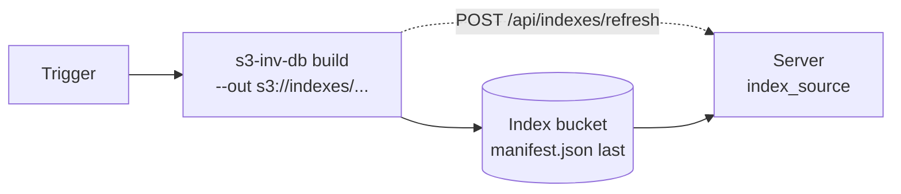

# Operations

Running `s3-inv-db-server`: what it does on its own, how to size its
disk and memory, and what to watch. Settings are in
[configuration](configuration.md).

## What the server does

- **Discovers runs.** Every `discovery_refresh_interval` (1m) it lists
  `s3_source` for `<source-bucket>/<inventory-id>/<timestamp>/`
  folders. Names outside the charsets AWS allows are skipped with a
  warning: source buckets `a-z 0-9 . -` (3–63 chars), inventory IDs
  `A-Z a-z 0-9 . - _` (1–64 chars, not `.` or `..`).
- **Builds on request.** Load (UI or API) queues a build job and
  returns 202; the page follows progress over server-sent events.
  `max_concurrent_jobs` (1) builds run at once.
- **Auto-loads.** With `auto_load`, every `auto_load_poll_interval`
  (15m) it builds the newest unloaded run of each auto-load
  configuration, among its newest `retention_count` runs (2). A failed
  auto-load backs off from 1 minute to 1 hour.
- **Keeps state** (runs, configurations, pins, job history) in
  `<cache_dir>/state.db` (SQLite). Finished jobs older than 30 days
  are pruned daily, keeping each run's last 20.

There is no built-in authentication: put the server behind your own
proxy or auth layer and list it in `trusted_proxies`.

## Disk budget

`max_index_disk` caps the bytes of loaded indexes; a fifth of it is
headroom. A load is admitted if its estimate fits; the estimate is
**0.30 × the manifest's compressed data size** (conservative; index
size follows prefix count, not object count). To make room the planner
evicts, in order: the same configuration's runs past retention, then
the least recently queried runs. It never evicts a pinned run (a
manual Load pins) or one being read: eviction waits for in-flight
queries before deleting.

The budget counts indexes only. **Size the volume for scratch too**:
at least 2× the largest manifest's compressed size, per concurrent
build, on top of `max_index_disk`.

For scale, a synthetic inventory measured (`BenchmarkLoadDiskPeak`):

| Objects | Index | Run-file scratch |
|---|---|---|
| 10 K | ~2.1 MB | ~0.6 MB |
| 100 K | ~18.6 MB | ~5.6 MB |
| 500 K | ~86.7 MB | ~26 MB |

An index is about 28 bytes per prefix (1M-object fixture: 2.37M
prefixes, 66.8 MB); prefixes, not objects, set its size.

## Cache directory

```
<cache_dir>/
├── state.db
└── <source-bucket>/<inventory-id>/
    ├── <run>/                      # a loaded index
    ├── .<run>.building-*/          # being built, renamed into place when complete
    └── .<run>.scratch-*/           # build scratch
```

A build never leaves a partial index: it writes to the hidden
directory and renames it into place only when complete. At startup the
server marks interrupted jobs `aborted` and interrupted loads `error`
(with Retry), reopens loaded runs, and removes leftover hidden
directories and runs it no longer has loaded. It removes only
directories that hold an index manifest, but keep indexes you build
yourself outside `cache_dir`.

## Memory

The memory limit is `GOMEMLIMIT` if set (capped by the cgroup
`memory.max`), otherwise `min(0.85 × cgroup memory.max, 0.6 × RAM)`:
the cgroup also charges page cache and mmap'd pages that the Go limit
doesn't see. At 4 GiB or less, `GOGC` drops to 50 unless set. The
startup log line `process memory limit configured` shows the result.
Only cgroup v2 is read; on v1 set `GOMEMLIMIT`.

Builds spill to stay inside the limit ([how it works](how-it-works.md#building)).
Two concurrent builds both size themselves from the whole limit, so
raise `max_concurrent_jobs` only with memory to spare.

Queries use the page cache: a warm server looking large is expected,
and the kernel takes it back under pressure. A newly loaded index is
prefaulted into the page cache if it fits in 1/8 of the server's
memory alongside the others already prefaulted (Linux 5.14+); an
evicted 2.4M-prefix index plus 1000 lookups took 36 ms instead of
77 ms. After a restart the server serves first and prefaults in the
background. Default readahead is kept on purpose: `MADV_RANDOM`
helps only workloads of a few queries per cold period (#50, #77).

## Builds outside the server

By default the server builds indexes itself. To build elsewhere (a
batch job, a bigger machine, CI) and only serve on the server:

```bash
s3-inv-db build --s3-manifest s3://inv/.../<source>/<inventory>/<run>/manifest.json \
  --out s3://indexes/prod/
```

The build uploads the index to
`s3://indexes/prod/<source>/<inventory>/<run>/`, its `manifest.json`
last: a run without one is still uploading and is ignored, as is one
whose manifest is of another version (published by an incompatible
build; republish it). Point the
server at it with `index_source: "s3://indexes/prod/"`:

- with `s3_source` too, loading a run downloads its published index if
  there is one, and builds in-process otherwise;
- without `s3_source`, the server lists runs from `index_source` and
  only downloads. It then needs no access to the inventories.

A download is verified against the manifest's CRC-32C checksums before
the index is used. Without `s3_source` it counts against the disk
budget at its exact size, read from the published manifest; with
`s3_source` too, a load reserves the same estimate as an in-process
build (the inventory's size times the index ratio), since the server
doesn't yet know whether it will download or build. The server notices new runs at the next poll; to make it look
now, call `POST /api/indexes/refresh` (for example as the build job's
last step).



What triggers the build is up to you; the server doesn't consume
events. Common choices:

- **Cron** (or a CI schedule): run `build` after the inventory's usual
  delivery time.
- **EventBridge:** a rule on `Object Created` for keys ending in
  `manifest.json` in the inventory bucket starts an AWS Batch or ECS
  task running `build` with that key. The server image works as the
  task image: it includes the CLI (entrypoint `s3-inv-db`, command
  `build --s3-manifest ... --out s3://...`).
- **S3 event notification:** a notification on `manifest.json` invokes
  a Lambda that starts the same ECS task.

Permissions: the build role reads the inventory bucket (`s3:GetObject`,
`s3:ListBucket`) and writes the index prefix (`s3:PutObject`,
`s3:DeleteObject`); the server role only reads the index bucket
(`s3:GetObject`, `s3:ListBucket`), plus the inventories if it also
builds.

## Monitoring

- `GET /healthz`: liveness.
- `GET /metrics`: Prometheus metrics.
- `GET /api/disk-budget`: cap, used, reserved, headroom, available.
- `GET /api/notifications`: recent failures (also shown as a banner).
- Build logs (info): `ingest phase complete`, `merge phase complete`
  and one `finalize step complete` per finalize step, each with its
  duration and how long it waited on storage: `major_faults`,
  `storage_read`/`storage_written`, and on Linux the system's
  `file_refaults` (page-cache thrash) and `io_stall_full`.

| Symptom | Likely cause | Fix |
|---|---|---|
| Low CPU during a build | S3 bandwidth | More vCPUs or network |
| Slow build, many run files | Spilling under a tight limit | Raise `GOMEMLIMIT` |
| Long final build phase | MPHF build | Expected past ~5M prefixes |
| A finalize step with high `major_faults` | Its scratch arrays don't fit in the page cache | More RAM, or fewer indexes loaded during builds |
| First queries slow | Cold page cache | Expected; prefault covers new loads |
| Load refused | Budget full of pinned runs | Unpin or raise `max_index_disk` |
